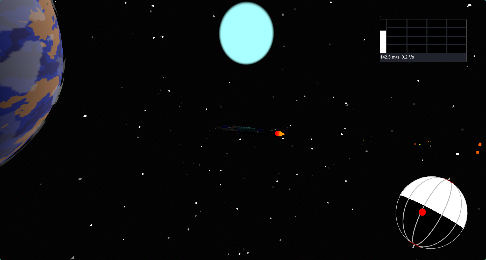

 [](https://godotengine.org) [](https://github.com/Ortley/black-hole-stars/releases)
# Black Hole Stars
A Sci-fi spaceship simulator and battler with realistic physics. For fans of KSP



This project is inspired by one of my most favorite games, Kerbal Space Program, a game where you run the Space Program on planet Kerbin. Currently in a very early stages i.e. pre-gameplay. So far includes object collisions, origin shifting, RCS control solving, PD rotation stabilising, in-flight info panels, weapon targeting, and some eyecandy ;)

As for my plans for the project, I'm thinking of including some fighting elements. I'm  particularly inspired by a book I recently read called Forever War, a 1974 hard sci-fi novel with some great worldbuilding. Give it a read!! Please!!!!

## Controls
| Control            | Keybind |
| ------------------ | ------- |
| Yaw                | A/D     |
| Pitch              | W/S     |
| Roll               | E/Q     |
| Stabilise rotation | Space   |
| Throttle up        | R       |
| Throttle down      | F       |

Panels can be resized and moved by moving the corners and the top face respectively

## Process
This project was made using Godot Engine v4.6.3 (stable.nixpkgs.35e80b3a8) with native tools to create assets. As the project progresses, more assets will be hand made, but right now I want to focus on the substance of the game 


## How to run

### Prebuilt binaries
Dev and release binaries can be found on the releases panel at https://github.com/Ortley/black-hole-stars/releases
- `dev-N` = dev build
- `vX.Y.Z` = release build

Supported platforms:
- Linux `arm32`, `arm64`, `x86_32`, `x86_64`
- Windows `arm64`, `x86_32`, `x86_64`
- Web
  > ( ! web version requires a server to run e.g. `python -m http.server` )
  > However, the server does not require COOP or COEP, since it packages with a service worker that spoofs these features (lmk if I'm just lying to your face)

### From source
Godot Version 4.6.3 was used during development. If errors occur use that version
```
git clone https://github.com/Ortley/black-hole-stars
cd black-hole-stars
godot project.godot # Or import using the Godot GUI 
```

My godot version
```
Godot Engine v4.6.3.stable.nixpkgs.35e80b3a8 - https://godotengine.org
Vulkan 1.4.354 - Forward+ - Using Device #1: NVIDIA - NVIDIA GeForce GTX 1660 Ti with Max-Q Design (NVK TU116)
```

